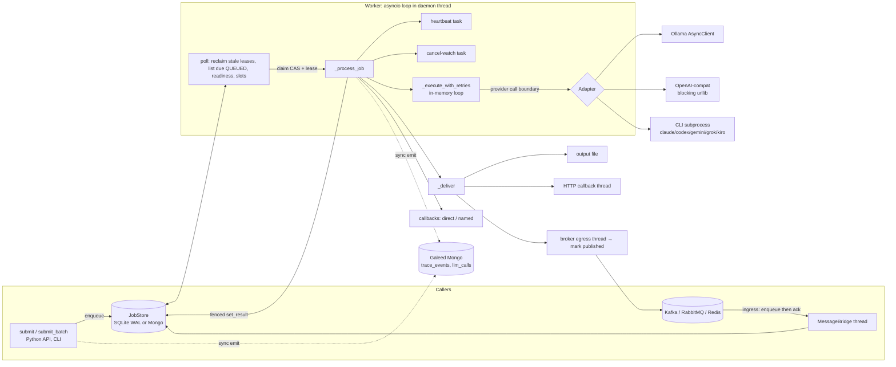

# Hoglah robustness analysis (2026-10-01)

An evidence-based analysis of how Hoglah v0.13.0 (`f0d322a`) fails, what state
each failure leaves behind, and what Hoglah must do so that **every credible
failure leaves it in a known, durable, diagnosable state from which the safest
available recovery can be taken**. Where an external outcome is unknowable,
Hoglah should say so rather than invent certainty.

This is a research phase. **No production code was changed.** Daemon and
service supervision is out of scope. Recovery *from* abrupt termination is in
scope.

| File | Contents |
|---|---|
| this README | **A** executive assessment · **B** architecture, execution and state map · answers to the completion questions |
| [FAILURE-CATALOG.md](FAILURE-CATALOG.md) | **C** catalogue (84 failure modes with risk vectors) · **E** 26 confirmed code weaknesses with file and line |
| [failure-catalog.yaml](failure-catalog.yaml) | the same catalogue with the full record schema, machine-readable |
| [PROVIDER-FAILURES.md](PROVIDER-FAILURES.md) | **D** Ollama, OpenAI-compatible, Claude Code, Codex, Gemini, Grok, Kiro; common subprocess failures kept separate |
| [ROBUSTNESS-REQUIREMENTS.md](ROBUSTNESS-REQUIREMENTS.md) | failure taxonomy · **F** 22 requirements · invariants · **G** Galeed observability · **H** recovery decision matrix · **J** implementation order |
| [FAULT-INJECTION-MATRIX.md](FAULT-INJECTION-MATRIX.md) | **I** 65 fault-injection test designs |
| [experiments/](experiments/README.md) | scripts that reproduce E01–E26 |
| [convergence/](convergence/) | the eight-iteration recursive attack loop (source, every iteration, score state) |

---

## A. Executive assessment

### Already strong

- **Fenced completion.** `set_result(…, lease_token)` is a conditional write. A worker that lost its lease cannot commit, on SQLite or on Mongo.
- **Atomic claim.** A conditional `UPDATE` on SQLite and `find_one_and_update` on Mongo. Two workers never both win a claim.
- **Idempotent enqueue.** UNIQUE `correlation_id` and `idempotency_key` indexes make broker redelivery and agent resubmission harmless within row retention.
- **Close-under-lock.** The connection is closed under its lock, which fixes the earlier segfault.
- **SSRF screening for callbacks.**
- **Broker ingress ordering.** Ingress enqueues before it acks, and the RabbitMQ egress uses publisher confirms.
- **Stub default and lightweight deployment.** SQLite is stdlib-only, with WAL and `busy_timeout`.
- **No CLI flag drift today.** Every flag Hoglah hard-codes exists in the installed Claude Code 2.1.287, Codex 0.157.1 and Grok 1.0.44.

### Incomplete

- **Retry is in memory.** Retries live inside one claim, with no persisted attempt counter. Classification falls back to regex over the whole message.
- **Leases use wall clocks.** They are compared across writers, and there is no monotonic confirmation.
- **Delivery.** HTTP callbacks, output files and named callbacks have no durable record. The broker outbox is swept only at startup.
- **Galeed integration.** Five lifecycle events, emitted synchronously, with failures logged at DEBUG.
- **Messaging bridges** lack seek-back (Kafka), reconnect (RabbitMQ) and periodic pending-entry claiming (Redis).

### Dangerous weaknesses (reproduced)

| | Weakness | Evidence |
|---|---|---|
| 1 | **Unknowable outcomes are silently re-run.** After a worker dies, a CLI agent job is executed again even with `max_retries=0`. A job that kills its worker runs forever. The orphaned CLI keeps running in its own session. | E12, E13, E14 |
| 2 | **Silent duplicate execution.** One transient heartbeat error, one clock jump past the lease (WSL after sleep), or one slow OpenAI-compatible request on the event loop each caused a second execution. | E03, E17, E06 |
| 3 | **Contradictory results.** Cancel overwrote a completed result. A store error after commit delivered "failed" for a completed job, and one before commit persisted "failed" after the provider had succeeded. | E02, E04, E23 |
| 4 | **Silent wrong success.** These were all stored as COMPLETED: streamed non-ASCII CLI output with 601 corrupted characters; an empty or stderr-only CLI answer; a prompt beginning with `-` parsed as a flag (`--version` made Claude and Codex exit 0 with their version string); Ollama's silent input truncation. | E07, E08, E19 |
| 5 | **Permanent silent stalls.** Waiting rows fill the poll window and starve their own dependency. One corrupt SQLite row stops every poll while `stats()` looks normal. Codex blocks forever on an inherited stdin pipe. | E01, E26, E09 |
| 6 | **Lost messages.** A transient store error on a Kafka message logs "not acking (will retry)", then commits past it. The message is gone. | E18 |
| 7 | **Operator data loss.** `hoglah clear` deletes *before* asking. Answering "n" prints "Clear cancelled." and the queued jobs are already gone. | E25 |
| 8 | **Observability that harms the queue.** With Galeed unreachable, every `submit()` blocks 2 s, worker throughput collapses, a direct callback was lost, and nothing is logged above DEBUG. | E05 |
| 9 | **A secret leak.** A per-job `metadata.api_key` is copied into results, output files and callback payloads. | E24 |

### Unknowns that still need testing

- **Mechanisms read from code but not reproduced:**
  - submitter retries that never resolve on RabbitMQ and Redis
  - Mongo ambiguous-write paths
  - RabbitMQ and Redis live-broker reconnect behaviour
  - batch-seal races, which concern a design that does not exist yet
- **Doc-only CLIs.** Gemini CLI and Kiro CLI are not installed; their rows are documentation and issue-tracker evidence only.
- **Unmeasured costs:** the recovery-time cost of the proposed monotonic reclaim window, and memory and VRAM exhaustion. Destructive tests were deliberately not run; OOM is covered by simulation and inference.

### Scope of the verdict

These are **robustness** findings, not style. Of 84 catalogue entries, 26 are
reproduced experiments (E01–E26), the rest are code-confirmed, documented, or
explicitly marked inference or theoretical. The ranking puts silent and
state-corrupting failures first, as the brief requires.

---

## B. Architecture and execution map

### Components and boundaries

Boundaries that matter for failure analysis:

| Boundary | Location |
|---|---|
| Storage | every `self._store.*` call, synchronous, on the loop |
| Lease | claim → heartbeat → fenced commit |
| Provider call | `_dispatch` → adapter |
| Retry | inside `_execute_with_retries`, inside one claim |
| Delivery | after commit: file, HTTP thread, broker thread, callbacks |
| Galeed | synchronous emits on the submit thread and the worker loop |
| Bridges | their own threads; egress outbox swept at startup only |

### Reconstructed job state machine (as implemented)

| Transition | Initiator | Persistent write | Atomicity | Process dies **before** | **during** | **immediately after** | Repeat-safe? |
|---|---|---|---|---|---|---|---|
| (none) → QUEUED | `submit` / bridge | INSERT row | single statement | nothing | rolled back | row exists; direct callback **not yet registered**; Galeed `job.queued` may be missing | yes with idempotency or correlation key; otherwise duplicates |
| QUEUED → PROCESSING | worker poll | conditional UPDATE + lease token + expiry | single statement | nothing | rolled back | PROCESSING with lease and no work; reclaimed after expiry | yes |
| PROCESSING (running) | heartbeat | UPDATE expiry, fenced by token | single statement | **provider may be mid-call: AMBIGUOUS** | — | — | heartbeat yes; provider call **no** |
| PROCESSING → PROCESSING (retry) | in-memory loop | **none** | — | retry count lost | — | — | **no record** |
| PROCESSING → COMPLETED/FAILED | worker | fenced `set_result` | single statement | **provider succeeded, result lost: AMBIGUOUS** | rolled back (same) | terminal row; **file, HTTP, callback and broker not yet delivered** (broker outbox recovers at startup; the others are lost) | commit yes; deliveries no |
| PROCESSING → QUEUED (reclaim) | any worker | conditional UPDATE | single statement | — | — | requeued; **no record of the interrupted attempt** | yes, but reruns a possibly-completed provider call |
| QUEUED/PROCESSING → CANCELLED | `cancel()` | **two unconditional writes** | none | — | CANCELLED without result row | CANCELLED; delivery as for completion | overwrites terminal rows (E02) |
| QUEUED → FAILED (dependency) | worker poll | claim + fenced write | two statements | — | — | as for completion | yes |
| FAILED/CANCELLED → QUEUED | operator | UPDATE, clears result and error | single statement | — | — | history erased | yes |
| any → deleted | `clear` / `remove` | DELETE | single statement | — | — | **non-terminal rows can be deleted** (E25) | n/a |

**Ambiguity windows.** These are the brief's "distributed-state ambiguity on one machine".
1. **Provider succeeded, result not yet persisted.** This covers any death between adapter dispatch and the fenced commit. Today it is invisible and rerun (E12). For CLI agents, the agent is also still running (FM-CLI-005).
2. **Result persisted, side effects not yet delivered.** A death between the commit and the file, HTTP or callback delivery loses those deliveries. Broker egress is recovered only at the next start (W14).
3. **Delivered, acknowledgement lost.** An HTTP receiver processed the POST but the response was lost, so the retry duplicates it, with no idempotency key today. The same applies to a broker produce with a lost ack (re-emit; correlation id dedupe exists).
4. **Broker message acknowledged, job not durable.** This is closed today by enqueue-before-ack, *except* Kafka's skip-on-failure (E18).
5. **Submitter publish unacknowledged.** The job may or may not exist, and a retry creates a second one (FM-BRIDGE-006).
6. **Lease lapsed while the provider still runs.** Two executions can then happen concurrently (E03, E06, E17).

[ROBUSTNESS-REQUIREMENTS.md](ROBUSTNESS-REQUIREMENTS.md) closes each window or represents it explicitly:
- Windows 1 and 6: ROB-AMBIG-001, ROB-LEASE-001/002
- Windows 2 and 3: ROB-DELIV-001
- Window 4: ROB-BRIDGE-001
- Window 5: ROB-BRIDGE-001

### Galeed integration today

`JobWitness` (`tracing.py`) emits `job.queued/started/completed/failed/cancelled`, with the job id as `trace_id`. When `galeed_capture_io` is on (the default), it also writes a full-I/O `llm_calls` record per job. Galeed writes are synchronous `insert_one` calls through a `MongoClient` with a 2 s server-selection timeout. All failures are swallowed at DEBUG. See [§G](ROBUSTNESS-REQUIREMENTS.md#g-galeed-observability-requirements) for the gaps and the required event set.

---

## Completion questions (§35 of the brief)

| # | Question | Answer, with evidence |
|---|---|---|
| 1 | What can fail inside Hoglah? | 57 internal failure modes in [FAILURE-CATALOG.md](FAILURE-CATALOG.md): core, retry, delivery, administration, batch, bridges, Galeed, storage and security. 26 confirmed code weaknesses with lines (§E). |
| 2 | What can fail outside Hoglah? | [PROVIDER-FAILURES.md](PROVIDER-FAILURES.md): 17 common subprocess failures, plus per-provider tables for Claude Code, Codex, Grok (probed), Gemini and Kiro (docs and issues), Ollama 0.23.4 (probed) and OpenAI-compatible servers. |
| 3 | What persistent state does each failure leave? | The `persistent_state_after` field for every entry in `failure-catalog.yaml`, and the reconstructed state machine above. |
| 4 | Can the operation be retried safely? | Today, not reliably: retries are regex-classified, in memory, and blind to ambiguity (E11, E12). The required rule is per idempotency class and category ([§H](ROBUSTNESS-REQUIREMENTS.md#h-recovery-decision-matrix)). |
| 5 | Can a job be recovered after total process death? | Yes for pure inference after lease expiry, although the attempt count is lost. For CLI agents recovery happens *unsafely*: they are rerun while the orphan may still be running (E12, E14). ROB-STATE-001, ROB-AMBIG-001 and ROB-CLI-001 make recovery decidable from the store alone. |
| 6 | Could recovery cause duplicate work or side effects? | Yes, as reproduced in E03, E12, E13 and E17. After the requirements, duplicates are possible only for the declared rerunnable class (at least once) and for deliveries deduped by `delivery_id`. |
| 7 | Could a job disappear or stay stuck indefinitely? | Today, yes. It can disappear (E18, E25) or stay stuck (E01, E09, E26; Ollama with no timeout). INV-10, ROB-CLI-001 and ROB-ADMIN-001 bound this. |
| 8 | Is every important failure centrally observable through Galeed? | Not today. There are five events, no categories, and failures logged at DEBUG. [§G](ROBUSTNESS-REQUIREMENTS.md#g-galeed-observability-requirements) specifies what is needed. |
| 9 | Can Galeed fail without taking Hoglah down? | It does not crash Hoglah, but it degrades it badly: 2 s per submit, loop stalls, and a lost callback (E05). ROB-LOG-001 and ROB-LOOP-001 make it non-blocking and visible. |
| 10 | Are provider errors mapped to a coherent taxonomy? | Not today: every CLI failure classifies as `[]` (E10). A canonical cause / action / state taxonomy is in [§1](ROBUSTNESS-REQUIREMENTS.md#1-canonical-failure-taxonomy). |
| 11 | Are unknown errors handled safely? | Today they are never retried and lose their exception class. The required policy is in §1.4 of the requirements. |
| 12 | Are critical recovery rules covered by deterministic tests? | No. The existing 232 tests pass, but none kills a process or injects mid-path store faults. ROB-TEST-001 and the 65-row matrix define them. |
| 13 | Have real CLI behaviours been compared with the code's assumptions? | Yes for Claude Code 2.1.287, Codex 0.157.1 and Grok 1.0.44 (flags, stdin, auth, bad model, prompt-as-flag, signals). Gemini and Kiro were not installed; documentation only, flagged. |
| 14 | Were documented robustness claims actively challenged? | Yes. "Exactly once" with Mongo is falsified by E03, E06 and E17. "Terminal is terminal" is falsified by E02. "Crash-safe" bridges are falsified for Kafka by E18. "A slow endpoint never blocks the worker" holds for callbacks but not for the OpenAI adapter (E06). "One claim, one execution while the lease is held" is falsified by E03 and E17. |
| 15 | Has the recursive analysis converged? | Yes. `recursive-confidence-loop` ran 8 iterations; the cap was raised from 6 to the skill default of 8 because the brief requires convergence. It reached STABILIZED: the score vector changed by ≤ 0.01 across the final window, and iterations 6 and 7 were consecutive non-material passes. Record in [convergence/](convergence/). Score stability is not verification: the residual unknowns above stand. |

---

## Method and provenance

1. **Code reading.** Read `src/hoglah` (11.6k lines) in dependency order, along with Galeed's `recorder.py` and `llm_calls.py`.
2. **Baseline.** The test suite passed: 232 passed and 18 skipped (live-service gates).
3. **Reproduction.** Each candidate was reproduced with throwaway scripts against temporary databases, fake CLIs and fake transports. Real providers were probed at minimal cost: bad-model, unauthenticated (isolated HOME, so the real credentials were never touched), `--version` and stdin-pipe probes, and Ollama with 0.14 GB and 0.27 GB models. The host was never rebooted, WSL was never terminated, and the real disk was never filled.
4. **Research.** Primary sources: Claude Code headless documentation, Codex non-interactive documentation, the Gemini CLI headless and troubleshooting docs and issues, the Kiro exit-code docs and issues, the Ollama FAQ, Confluent offset semantics, and the microsoft/WSL clock-skew issues. Links are in [PROVIDER-FAILURES.md](PROVIDER-FAILURES.md).
5. **Recursive attack loop.** Eight fresh-context iterations each attacked recovery mechanisms, propagation, state reconstruction, silent failure, idempotency, Galeed reconstructability and simplification. The parent re-verified the iterations' strongest new claims by experiment before accepting them:
   - E23: pre-commit read failure
   - E25: `clear` deletes despite "n"
   - E26: one corrupt row stalls the worker
   - the `messaging_submitter` correlation-id defect
6. **Evidence labelling.** Every claim is labelled observed, code, documented, issue, inference or theoretical.
